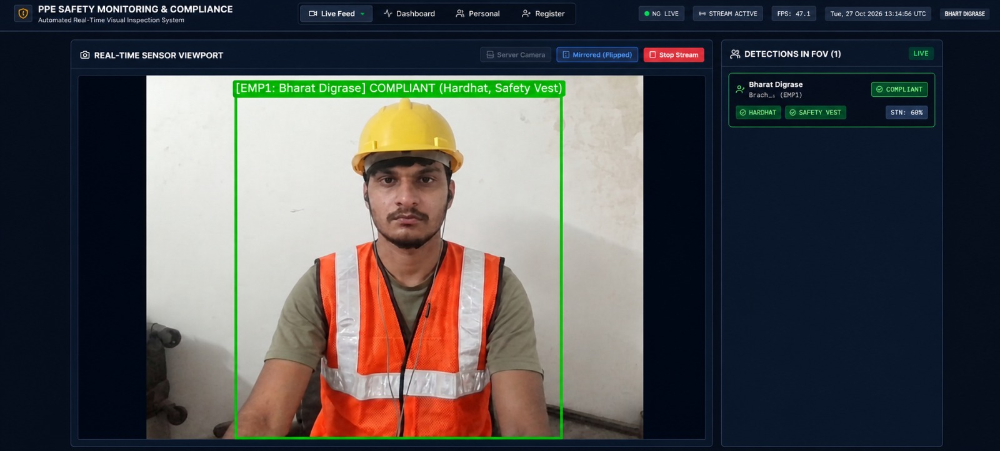
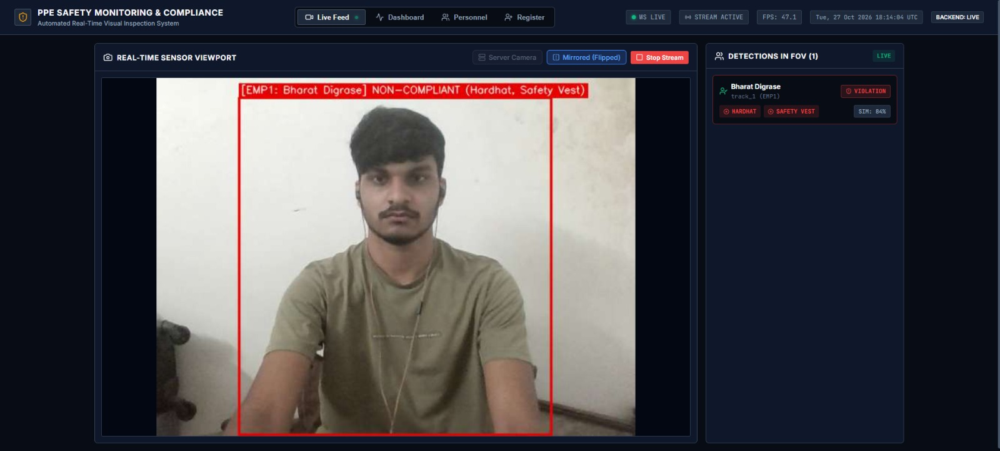
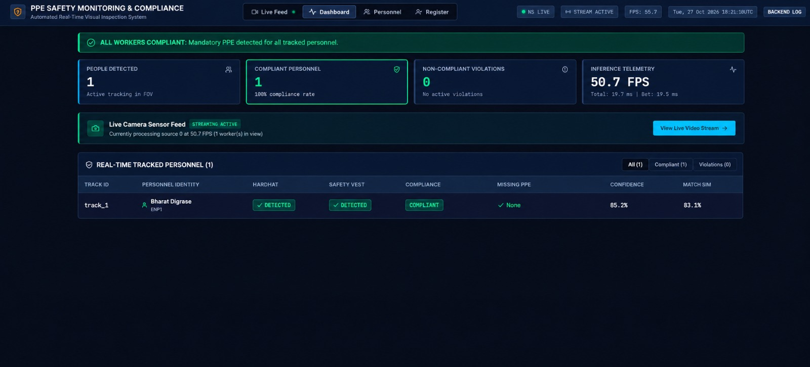
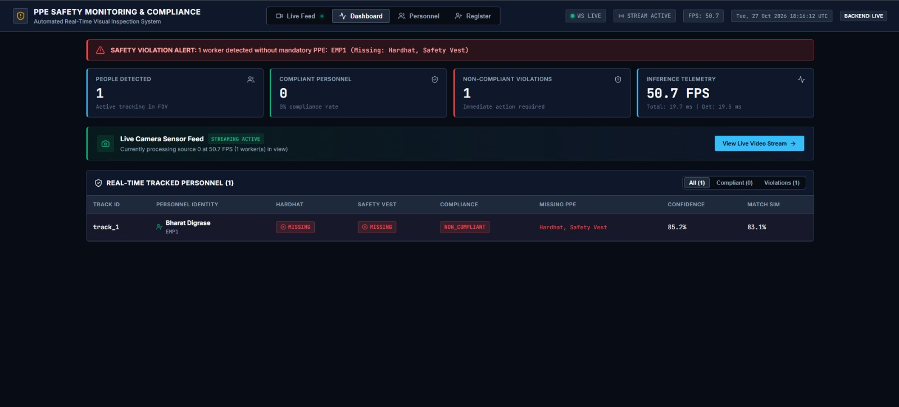
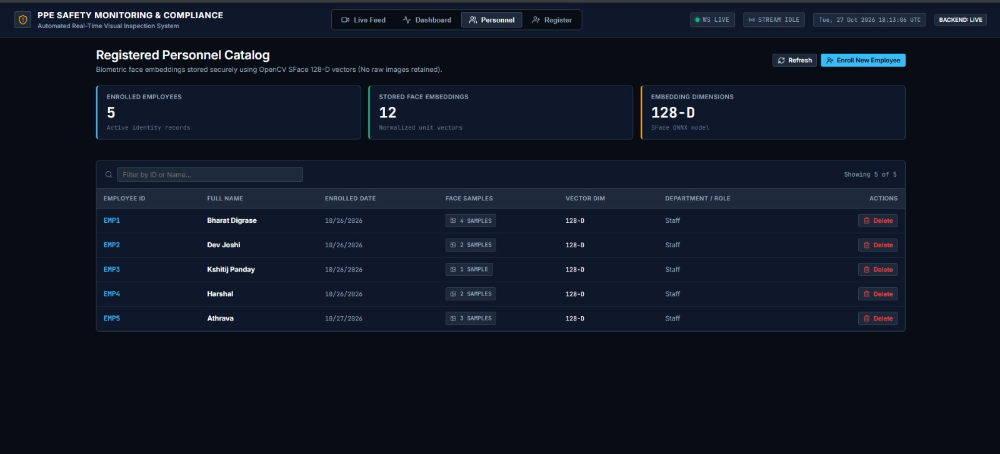

# Real-Time PPE Safety Monitoring & Compliance System

**Academic Deep Learning Capstone Project**

An end-to-end automated Personal Protective Equipment (PPE) detection and safety compliance platform utilizing YOLOv8n, deterministic anatomical association, OpenCV YuNet/SFace biometric verification, sliding-window temporal smoothing, a FastAPI backend with WebSocket telemetry, and a React + Vite real-time industrial dashboard.

---

## Sample Output

**Live Feed — worker wearing hardhat and safety vest (COMPLIANT, green box)**


**Live Feed — same worker without PPE (NON-COMPLIANT, red box)**


**Dashboard — all tracked workers compliant**


**Dashboard — violation alert with missing items listed**


**Personnel catalog — enrolled employees stored as 128-D face embeddings (no photos kept)**


In each case the worker is identified by face (`EMP1: Bharat Digrase`, match similarity ~83–84%) and the
hardhat / vest status is updated live. All screenshots are in [docs/screenshots/](docs/screenshots/).

---

## Project Structure

```
ppe-compliance/
├── backend/            FastAPI server: REST routes, WebSocket, background inference worker
│   ├── routes/         /health, /employees, /monitoring endpoints
│   ├── schemas/        Pydantic request/response models
│   ├── services/       Monitoring worker, employee store, violation event log
│   └── static/         Pre-built React dashboard (served at http://localhost:8000)
├── detection/          YOLOv8 detector, PPE-to-person association, full pipeline, webcam demo
├── recognition/        Face detection (YuNet) + 128-D embeddings (SFace) + employee registration
├── compliance/         Compliance rules and sliding-window temporal filter (anti-flicker)
├── config/             Central settings and logging setup
├── training/           train.py (YOLOv8n training) and evaluate.py (precision/recall/mAP)
├── scripts/            Dataset preparation/checking/visualisation, benchmarking, model comparison
├── models/
│   ├── weights/        Trained PPE detector weights (.pt and .onnx)
│   └── face/           YuNet face detector + SFace recogniser (ONNX)
├── data/employees/     Enrolled employee records and face embeddings (.npz)
├── frontend/           React + Vite dashboard source code
├── tests/              Pytest suite (203 tests)
├── docs/               Architecture, data flow, evaluation, limitations, screenshots
├── requirements.txt    Python dependencies
└── start.bat / stop.bat  One-click launch / shutdown on Windows
```

---

## Model Weights

All weights needed to run the system are included in the repository — no download is required.

| File | Purpose | Classes |
|---|---|---|
| `models/weights/best.pt` | **Main PPE detector** (YOLOv8n, PyTorch). Used by default by the backend, webcam and pipeline. | 5: Person, Hardhat, NO-Hardhat, Safety Vest, NO-Safety Vest |
| `models/weights/best_5class.onnx` | Same 5-class detector exported to ONNX, used for CPU-only / cloud deployment (Render). | 5 |
| `models/weights/ppe_5class_best.pt` / `.onnx` | 5-class candidate model used in the evaluation comparison. | 5 |
| `models/weights/best_25class.pt` | Baseline model trained on the full 25-class dataset (for comparison only). | 25 |
| `models/face/face_detection_yunet_2023mar.onnx` | OpenCV YuNet face detector. | — |
| `models/face/face_recognition_sface_2021dec.onnx` | OpenCV SFace face recogniser (128-D embeddings). | — |
| `yolov8n.pt` | COCO-pretrained YOLOv8n, the starting point for training. | 80 (COCO) |

Accuracy figures for these models are in [Evaluation](#4-evaluation) and [docs/evaluation.md](docs/evaluation.md).

---

> 🚀 **DEMONSTRATION & VIVA PREPARATION:**
> - 🗣️ **[What_To_Tell_Mam_Tomorrow_Demonstration_Script.docx](What_To_Tell_Mam_Tomorrow_Demonstration_Script.docx)** — Word-for-word spoken speech script, live demo actions, and viva answers.
> - 📄 **[PPE_Compliance_Project_Demonstration_Guide.docx](PPE_Compliance_Project_Demonstration_Guide.docx)** — Complete formatted project & architecture report.
> - 📖 **[DEMO_README.md](DEMO_README.md)** — Master demonstration guide, accuracy metrics, and tech breakdown.

---

## Architecture & Documentation Index

- [Project Demonstration & Viva Guide](DEMO_README.md) — Master demonstration script, live accuracy evaluation, and viva defense guide.
- [System Architecture](docs/system_architecture.md) — Comprehensive subsystem breakdown and component boundaries.
- [Data Flow Specification](docs/data_flow.md) — Exact data structures, coordinate spaces, and sequence diagrams.
- [Model Evaluation Report](docs/evaluation.md) — Empirical precision, recall, mAP, and latency benchmark results.
- [Known Limitations](docs/known_limitations.md) — Optical boundaries, occlusion, pose angles, and operational constraints.
- [Face Recognition & Privacy](docs/face_recognition.md) — Privacy-preserving 128-D biometric enrollment pipeline.
- [PPE Spatial Association](docs/ppe_association.md) — Geometric priors and anatomical region scoring formulas.

---

## Quick Start (One-Click Launch)

On Windows, double-click **`start.bat`** (or run `.\start.bat` from terminal):

```cmd
start.bat
```

This single command will automatically:
1. Validate dependencies in `.venv` and `frontend/node_modules`.
2. Start the **FastAPI Backend Server** on `http://127.0.0.1:8000`.
3. Start the **React Dashboard** on `http://localhost:5173`.
4. Open your default browser directly to the dashboard.

To shut down all running servers, run **`stop.bat`**.

### Execution Steps (any OS, step by step)

```bash
# 1. Create and activate a virtual environment (Python 3.11)
python -m venv .venv
.venv\Scripts\activate            # Windows
# source .venv/bin/activate       # Linux / macOS

# 2. Install Python dependencies
pip install -r requirements.txt

# 3. Start the backend (it also serves the pre-built dashboard)
python -m uvicorn backend.main:app --host 127.0.0.1 --port 8000

# 4. Open the app in a browser
#    http://localhost:8000/live       -> Live Feed (allow camera access)
#    http://localhost:8000/dashboard  -> Dashboard
#    http://localhost:8000/docs       -> API documentation
```

Then:
1. Go to **Register**, enter an ID and name, and capture 2–4 face photos to enrol yourself.
2. Go to **Live Feed** and click **Start Stream**. Your box turns **green** when a hardhat and safety vest
   are detected and **red** when either is missing; your name appears once your face is recognised.
3. Open **Dashboard** for the live counts and the violation alert, and **Violations** for the event history.

Node.js is only needed if you want to edit the frontend (`cd frontend && npm install && npm run dev`).

---

## 1. Installation

### Prerequisites
- Python 3.11 (recommended for CUDA 12.4 compatibility on Windows/Linux)
- Node.js v18+ (tested on v24.11.1) and npm v10+
- Git

### 1.1 Python Environment & Virtualenv
```bash
# Clone the repository
git clone <repo-url>
cd ppe-compliance

# Create dedicated virtual environment
py -3.11 -m venv .venv
.venv\Scripts\activate          # Windows PowerShell / CMD
# source .venv/bin/activate     # Linux / macOS
```

### 1.2 PyTorch & Core Dependencies
```bash
# For NVIDIA GPUs (CUDA 12.4):
pip install torch torchvision --index-url https://download.pytorch.org/whl/cu124
pip install -r requirements.txt

# Verify GPU detection:
python -c "import torch; print('CUDA Available:', torch.cuda.is_available(), '| Device:', torch.cuda.get_device_name(0) if torch.cuda.is_available() else 'CPU')"
```

### 1.3 Frontend Dependencies
```bash
cd frontend
npm install
cd ..
```

---

## 2. Dataset Setup

> The dataset is **not** included in this repository because of its size. Download it with the steps below.
> You only need it to re-train or re-evaluate the model — running the app uses the included weights.

**Dataset:** Construction Site Safety (Roboflow Universe, YOLOv8 format, 25 classes)
**Link:** https://universe.roboflow.com/roboflow-universe-projects/construction-site-safety

The 25 classes include Person, Hardhat, NO-Hardhat, Safety Vest, NO-Safety Vest, plus 20 background classes
(vehicles, machinery, cones, etc.). We filter it down to the 5 PPE classes, which improved mAP@50 by +9.1%.

### 2.0 Download & Prepare
1. Open the link above, click **Download Dataset**, choose format **YOLOv8**, and download the ZIP
   (a free Roboflow account is needed).
2. Extract it, e.g. to `data/raw/construction-site-safety/` (it contains `train/`, `valid/`, `test/` and `data.yaml`).
3. Build the 5-class dataset used for training:
   ```bash
   python scripts/prepare_5class_dataset.py --source data/raw/construction-site-safety --output data/processed/ppe_5class
   ```
   This writes `data/processed/ppe_5class/data.yaml`, which is the `--data` path used in the Training and Evaluation steps below.

### 2.1 Dataset Validation
Validate data hierarchy, label coordinates, bounding box bounds, and class distribution:
```bash
# Inspect dataset and generate console statistics
python scripts/check_dataset.py path/to/dataset

# Generate structured JSON report
python scripts/check_dataset.py path/to/dataset --json --output outputs/dataset_report.json
```

### 2.2 Dataset Visualization
Inspect sample images with overlaid ground truth annotations:
```bash
# View 5 interactive random training images
python scripts/visualize_dataset.py path/to/dataset

# Save annotated samples to disk
python scripts/visualize_dataset.py path/to/dataset --split valid --count 10 --save-dir outputs/viz
```

---

## 3. Training

Train the lightweight YOLOv8n detector with automatic path correction and experiment tracking:

```bash
# Standard 50-epoch training on GPU
python training/train.py --data path/to/data.yaml --epochs 50 --batch 16 --device auto

# Custom CPU or experiment run
python training/train.py --data path/to/data.yaml --epochs 100 --batch 8 --device cpu --name custom_experiment
```
Weights, confusion matrices, and loss curves are saved to `runs/train/<experiment_name>/`. The best model is automatically saved to `models/weights/best.pt`.

---

## 4. Evaluation

Evaluate the trained detector against validation or test splits:

```bash
# Evaluate best model weights on validation split
python training/evaluate.py --model models/weights/best.pt --data data/processed/ppe_5class/data.yaml --split val --device auto

# Compare baseline model vs 5-class candidate model on identical test data
python scripts/compare_models.py --baseline outputs/evaluation/results.json --candidate models/weights/ppe_5class_best.pt --data data/processed/ppe_5class/data.yaml --split test

# Benchmark real-time latency with FP16 half-precision on GPU
python scripts/benchmark.py --model models/weights/best.pt --iterations 100 --half
```

Outputs:
- `outputs/evaluation/results.json` — Machine-readable evaluation metrics.
- `outputs/evaluation/report.txt` — Formatted human-readable report.
- `outputs/evaluation/model_comparison.json` — Side-by-side empirical accuracy gains.

### Empirical Model Comparison (Test Split, 82 Images, 476 Instances):
| Metric | Baseline (25-Class) | Candidate (Clean 5-Class) | Empirical Delta | Relative Gain |
|---|---|---|---|---|
| **mAP@50** | `52.41%` | **`61.53%`** | **`+9.12%`** | **+17.4%** |
| **mAP@50-95** | `36.86%` | **`38.19%`** | **`+1.33%`** | **+3.6%** |
| **Precision** | `69.71%` | **`78.63%`** | **`+8.92%`** | **+12.8%** |
| **Recall** | `48.71%` | **`58.03%`** | **`+9.32%`** | **+19.1%** |
| **Hardhat Precision** | `87.27%` | **`94.47%`** | **`+7.20%`** | **+8.3%** |

*(Detailed per-class metrics and FP16 throughput figures are documented in [docs/evaluation.md](docs/evaluation.md)).*

---

## 5. Webcam Inference

Run standalone real-time inference directly on a connected camera stream:

```bash
# Launch on default webcam (Device index 0)
python detection/webcam.py --camera 0

# Set resolution and confidence threshold
python detection/webcam.py --camera 0 --width 1280 --height 720 --confidence 0.35

# Full integration pipeline on test video
python detection/pipeline.py --video path/to/video.mp4

# Full integration pipeline on test image (headless)
python detection/pipeline.py --image path/to/image.jpg --save-output outputs/annotated.jpg --headless
```
*Controls*: Press `Q` or `Esc` to quit active display windows.

---

## 6. Face Registration

Enroll employees into the local biometric face database. Extracts aligned 128-D normalized embeddings using OpenCV YuNet + SFace. **Raw face photos are never saved to disk.**

```bash
# CLI enrollment with multiple facial photos
python recognition/registration.py --id EMP101 --name "Dr. Jane Chen" --images photo1.jpg photo2.jpg photo3.jpg
```

Python API:
```python
from recognition import EmployeeRegistrationService

service = EmployeeRegistrationService()
result = service.register_employee(
    employee_id="EMP101",
    employee_name="Dr. Jane Chen",
    images=["photo1.jpg", "photo2.jpg"],
)
print(result.message)
# "Successfully registered 'Dr. Jane Chen' (ID: EMP101) using 2 sample(s)."
```

---

## 7. Backend

The FastAPI backend isolates ML inference into a dedicated background worker thread and exposes REST endpoints alongside a low-latency WebSocket channel.

```bash
# Launch backend server on port 8000
uvicorn backend.main:app --host 0.0.0.0 --port 8000 --reload
```

Interactive OpenAPI documentation is available at `http://localhost:8000/docs`.

### REST & WebSocket API Specification
| Method | Endpoint | Description |
|---|---|---|
| `GET` | `/health` | Service uptime, compute device, and model readiness status |
| `GET` | `/employees` | List all enrolled personnel with sample counts |
| `POST` | `/employees` | Enroll employee with face images (`multipart/form-data`) |
| `GET` | `/employees/{id}` | Look up single employee record |
| `DELETE` | `/employees/{id}` | Delete employee record and embedding vectors |
| `GET` | `/monitoring/status` | Instant structured snapshot of all tracked persons |
| `POST` | `/monitoring/start` | Start background video inference worker (`{"source": 0}`) |
| `POST` | `/monitoring/stop` | Terminate background video inference worker |
| `WebSocket` | `/ws/monitoring` | Real-time structured PPE events (No raw video frames) |

---

## 8. Frontend

The React + Vite frontend is designed specifically with an industrial safety monitoring visual language:

```bash
# Navigate to frontend and start dev server
cd frontend
npm run dev

# Build production bundle
npm run build
```
Dashboard is live at `http://localhost:5173`.

### Dashboard Pages
1. `/dashboard` — Live sensory canvas with coordinate-scaled worker bounding boxes, active violation alert banner, KPI cards, and live tracked personnel table.
2. `/employees` — Personnel database catalog, search filtering, and deletion controls.
3. `/register` — Biometric enrollment form with drag-and-drop face image uploads and instant previews.

### Cloud Deployment (Render)
The backend also serves the dashboard, so the whole app is available from the Render URL
(e.g. `https://ppe-compliance-backend-dpzr.onrender.com/live`). The built site lives in
`backend/static/`. **After changing anything in `frontend/`, rebuild and commit it:**

```bash
cd frontend
npm run build:render   # writes ../backend/static
```

On Render the detector runs with ONNX Runtime (`models/weights/best_5class.onnx`) to stay
within the free tier's 512 MB RAM, and the Live page uses the viewer's own webcam.

---

## 9. Benchmarking

Run empirical latency, throughput, and memory profiling across individual components and the unified pipeline:

```bash
# Benchmark across 50 iterations on active GPU
python scripts/benchmark.py --iterations 50 --device auto
```

### Measured Performance (NVIDIA GeForce RTX 4050 Laptop GPU, 640×480):
| Subsystem Stage | Mean (ms) | P95 (ms) | P99 (ms) | Throughput |
|---|---|---|---|---|
| **YOLOv8 Detection** | `8.69 ms` | `12.57 ms` | `13.55 ms` | **115.1 FPS** |
| **Spatial Association** | `0.01 ms` | `0.05 ms` | `0.07 ms` | **>10,000 FPS** |
| **Face Feature Extraction** | `1.10 ms` | `1.48 ms` | `1.71 ms` | **911.0 FPS** |
| **Temporal Smoothing** | `0.02 ms` | `0.06 ms` | `0.09 ms` | **>10,000 FPS** |
| **Full End-to-End Pipeline** | `8.85 ms` | `12.94 ms` | `23.99 ms` | **113.0 FPS** |

Results are automatically saved to `outputs/benchmark_results.json`.

---

## 10. Troubleshooting

| Issue | Root Cause | Solution |
|---|---|---|
| `OpenCV: cv::dnn Targets are not supported` | Informational OpenCV DNN warning on newer OpenCV versions | Harmless warning; inference continues normally on CPU/GPU fallback |
| `Failed to initialize camera source '0'` | Webcam is occupied by another application or permissions are disabled | Close Zoom/Teams/OBS; enable camera permissions in Windows Privacy Settings |
| `Registration failed: No face detected` | Face photo is too dark, blurry, or subject is looking away ($>45^\circ$) | Provide well-lit, frontal portrait photos with clear facial features |
| `Registration failed: Multiple faces detected` | Enrollment image contains background individuals | Crop image to ensure only the target employee's face is visible |
| `WebSocket connection to ws://... failed` | Backend server is not running on port 8000 | Verify backend is launched via `uvicorn backend.main:app --port 8000` |
| `CUDA out of memory during training` | Batch size too large for GPU VRAM | Decrease batch size (e.g. `--batch 8` or `--batch 4`) in `training/train.py` |

---

## Test Suite Execution

Run the complete automated test suite (203 tests covering compliance rules, spatial association, temporal filters, face registration, REST routes, and WebSockets):

```bash
.venv\Scripts\python.exe -m pytest tests/ -v
# 203 passed in ~6s
```

---

## License
Academic and educational capstone use only.
