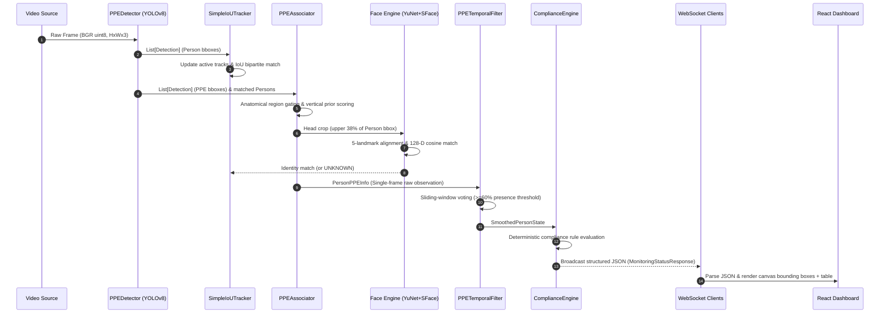

# Data Flow Specification

## 1. End-to-End Data Transformation Pipeline

This document defines the exact data structures, coordinate spaces, and transformation stages traversed by every video frame in the PPE compliance monitoring system.



---

## 2. Stage-by-Stage Data Schemas

### Stage 1: Raw Video Frame
- **Type**: `numpy.ndarray`
- **Shape**: `(H, W, 3)` in BGR format, `dtype=uint8`.
- **Coordinate Space**: Top-left origin `(0, 0)` to bottom-right `(W - 1, H - 1)`.

### Stage 2: YOLO Perceptual Output (`Detection`)
```python
@dataclass(frozen=True)
class Detection:
    x1: int               # Pixel coordinate
    y1: int
    x2: int
    y2: int
    class_id: int         # 8=Person, 2=Hardhat, 5=NO-Hardhat, 11=Safety Vest, 7=NO-Safety Vest
    class_name: str       # Exact label string from model metadata
    confidence: float     # In range [0.0, 1.0]
```

### Stage 3: Tracked Object State (`ActiveTrack`)
```python
@dataclass
class ActiveTrack:
    track_id: str                          # e.g. "track_1"
    bbox: Tuple[int, int, int, int]        # Smoothed bounding box
    confidence: float                      # Current detection confidence
    last_seen_frame: int                   # Frame index of last positive match
    employee_id: str = "UNKNOWN"           # Verified ID or "UNKNOWN"
    employee_name: str = "UNKNOWN"         # Verified full name or "UNKNOWN"
    face_similarity: Optional[float] = None # Cosine similarity score [0.0, 1.0]
    face_attempts: int = 0                 # Face inference retry counter
```

### Stage 4: Anatomical Association (`AssociatedPerson`)
```python
@dataclass
class AssociatedPerson:
    person: Detection
    hardhats: List[Detection]         # Confirmed hardhats in head region
    no_hardhats: List[Detection]      # Confirmed bare-head detections
    safety_vests: List[Detection]     # Confirmed safety vests in torso region
    no_safety_vests: List[Detection]  # Confirmed bare-torso detections
```

### Stage 5: Temporal Voting State (`SmoothedPersonState`)
```python
@dataclass
class SmoothedPersonState:
    person_id: str
    has_hardhat: bool                  # Voting outcome (observed in >=60% of window)
    has_safety_vest: bool              # Voting outcome (observed in >=60% of window)
    is_compliant: bool                 # has_hardhat AND has_safety_vest
    status: ComplianceStatus           # COMPLIANT or NON_COMPLIANT
    history_length: int                # Number of frames evaluated (1 to 10)
    window_size: int                   # Max window capacity (10)
    presence_ratios: Dict[str, float]  # e.g. {"Hardhat": 0.90, "Safety Vest": 0.80}
    missing_equipment: List[str]       # e.g. ["Hardhat"] or []
```

### Stage 6: Consolidated Output Record (`TrackedPersonRecord`)
Exported to dictionary via `record.to_dict()`:
```json
{
  "track_id": "track_1",
  "employee_id": "EMP001",
  "employee_name": "Jane Doe",
  "hardhat": true,
  "safety_vest": true,
  "compliance_status": "COMPLIANT",
  "missing_items": [],
  "detection_confidence": 0.942,
  "bbox": [120, 80, 280, 420],
  "is_compliant": true,
  "face_similarity": 0.781
}
```

### Stage 7: WebSocket Broadcast Payload
Streamed to all connected frontend clients at native frame rates without raw pixels:
```json
{
  "type": "monitoring_update",
  "data": {
    "is_active": true,
    "source": "0",
    "total_tracked": 1,
    "compliant_count": 1,
    "non_compliant_count": 0,
    "persons": [
      {
        "track_id": "track_1",
        "employee_id": "EMP001",
        "employee_name": "Jane Doe",
        "hardhat": true,
        "safety_vest": true,
        "compliance_status": "COMPLIANT",
        "missing_items": [],
        "detection_confidence": 0.942,
        "bbox": [120, 80, 280, 420],
        "is_compliant": true,
        "face_similarity": 0.781
      }
    ],
    "telemetry": {
      "fps": 31.4,
      "total_ms": 31.8,
      "detection_ms": 11.5,
      "association_ms": 2.3,
      "recognition_ms": 16.2,
      "smoothing_ms": 1.8
    },
    "timestamp": "2026-09-26T06:15:00.000000Z"
  }
}
```

### Stage 8: Frontend Canvas Rendering
- The React canvas component receives normalized bounding boxes `[bx1, by1, bx2, by2]` defined in reference space `(640, 480)`.
- It dynamically computes horizontal and vertical scale factors:
  $$\text{scale}_X = \frac{\text{canvas.width}}{640}, \quad \text{scale}_Y = \frac{\text{canvas.height}}{480}$$
- Transforms coordinates:
  $$X = bx_1 \times \text{scale}_X, \quad Y = by_1 \times \text{scale}_Y, \quad W = (bx_2 - bx_1) \times \text{scale}_X, \quad H = (by_2 - by_1) \times \text{scale}_Y$$
- Renders bounding boxes with green/red status styling, corner target brackets, worker identity labels, and telemetry overlay HUD.
