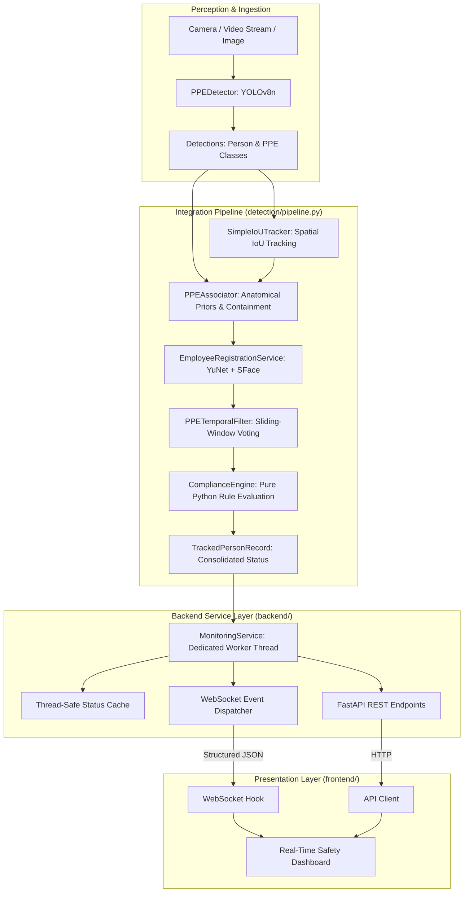

# System Architecture

## 1. Overview & High-Level Architecture

The Personal Protective Equipment (PPE) Compliance and Real-Time Safety Monitoring System is a modular deep learning platform designed for industrial, laboratory, and construction site environments. It automates visual safety audits by tracking individuals, associating safety equipment to their respective body regions, identifying enrolled personnel, filtering single-frame detection flickers, and broadcasting structured compliance telemetry in real-time.

---

## 2. Subsystem Breakdown

### 2.1 Object Detection Subsystem (`detection/detector.py`)
- **Model**: YOLOv8n (`models/weights/best.pt`), fine-tuned for 50 epochs on 25 classes (including Person, Hardhat, NO-Hardhat, Safety Vest, NO-Safety Vest).
- **Inference Runtime**: Ultralytics PyTorch runtime with automatic GPU acceleration (`cuda:0` on NVIDIA RTX 4050 Laptop GPU, fallback to CPU).
- **Output Container**: `DetectionResult` containing bounding boxes (`x1, y1, x2, y2`), class IDs, string class names, and confidence scores.

### 2.2 Multi-Object Spatial Tracker (`detection/pipeline.py::SimpleIoUTracker`)
- **Algorithm**: Greedy bipartite matching based on bounding-box Intersection-over-Union (IoU $\ge 0.30$).
- **Lifecycle Management**:
  - Assigns monotonic unique identifiers (`track_1`, `track_2`, ...).
  - Maintains persistent employee identity across frames.
  - Prunes tracks that have disappeared for more than `max_missed=15` consecutive frames.

### 2.3 Spatial Person-to-PPE Associator (`detection/ppe_association.py`)
- **Principle**: Deterministic geometric association incorporating human anatomical priors:
  - **Hardhat**: Candidate must lie in the upper 30% of the person's bounding box ($Y_{rel} \in [-0.20, 0.30]$).
  - **Safety Vest**: Candidate must overlap the torso region ($Y_{rel} \in [0.15, 0.75]$).
- **Disambiguation**: Multi-person overlap is resolved via containment ratios, distance to vertical midline, and detection confidence scoring. Unassigned PPE items are flagged separately.

### 2.4 Biometric Face Recognition (`recognition/embeddings.py`, `recognition/registration.py`)
- **Models**:
  - Face Detection & 5-point Alignment: OpenCV `FaceDetectorYN` (YuNet ONNX).
  - Feature Extraction: OpenCV `FaceRecognizerSF` (SFace ONNX, 128-D L2-normalized unit vectors).
- **Identity Policy**: Strict cosine threshold ($0.363$). Unrecognized or ambiguous faces remain strictly `UNKNOWN`. Identities are never forced.
- **Privacy Architecture**: Raw employee photos are processed entirely in volatile memory and discarded. Only mathematical embedding arrays are persisted.

### 2.5 Safety Compliance Rule Engine (`compliance/rules.py`)
- **Architecture**: Pure Python, zero-dependency rule engine.
- **Mandated Standard**: Hardhat present AND Safety Vest present $\implies$ `COMPLIANT`. Any missing item $\implies$ `NON_COMPLIANT`.
- **Extensibility**: Custom PPE items (Gloves, Mask, Eye Protection) can be dynamically registered without altering code.

### 2.6 Temporal Smoothing Filter (`compliance/temporal_filter.py`)
- **Mechanism**: Per-track sliding history window (default: 10 frames).
- **Voting**: Declares PPE stable present only if detected in $\ge 60\%$ of window observations.
- **Anti-Flicker**: Absorbs single-frame detection drops (e.g. momentary head turns or motion blur) without triggering false safety alerts.

### 2.7 Backend & WebSocket Service (`backend/`)
- **Inference Isolation**: Runs in a dedicated background daemon thread (`MonitoringService._worker_loop`), guaranteeing that OpenCV/YOLO inference never starves the ASGI/Uvicorn event loop.
- **Real-Time Streaming**: Broadcasts structured JSON events over WebSockets (`/ws/monitoring`). Video frames are strictly omitted from WebSocket payloads to conserve bandwidth.
- **CORS & REST**: Clean REST API (`/health`, `/employees`, `/monitoring/status`) built with Pydantic schemas.

### 2.8 Frontend Dashboard (`frontend/`)
- **Stack**: React 19 + Vite + Vanilla CSS.
- **Visual Language**: Clean industrial safety monitoring theme (ISO/OSHA color codes, high-contrast dark theme, JetBrains Mono telemetry).
- **Components**: Live canvas viewport with dynamically scaled bounding boxes, KPI stat cards, tracked personnel status table, and employee biometric enrollment.

---

## 3. Modularity & Architectural Boundaries

| Layer | Depends On | Does NOT Depend On |
|---|---|---|
| `compliance/rules.py` | Pure Python standard library | OpenCV, Torch, FastAPI, React |
| `compliance/temporal_filter.py` | `compliance.rules` | OpenCV, Torch, FastAPI |
| `detection/detector.py` | OpenCV, Ultralytics, PyTorch | FastAPI, React |
| `recognition/` | OpenCV DNN (ONNX) | YOLO, Ultralytics, FastAPI |
| `detection/pipeline.py` | Detector, Associator, Face, Rules, Filter | FastAPI, React |
| `backend/` | Pipeline, FastAPI, Uvicorn, Pydantic | React frontend |
| `frontend/` | React, Vite | Backend internal Python classes |
